<div align="center">

# IntelligenceOS

**Every answer is computed. None of them are guessed.**

Ask plain-English questions of your data. A deterministic warehouse engine computes every figure.<br/>
A language model may read your question and phrase the summary. It never computes a number.

[**Live demo**](https://intelligenceos.xyz) &nbsp;·&nbsp; [How it works](#how-it-works) &nbsp;·&nbsp; [Architecture](#architecture) &nbsp;·&nbsp; [Quick start](#quick-start)

[](https://github.com/Azizul-11/intelligence-os/actions/workflows/ci.yml)
[](LICENSE)


</div>

<p align="center">
  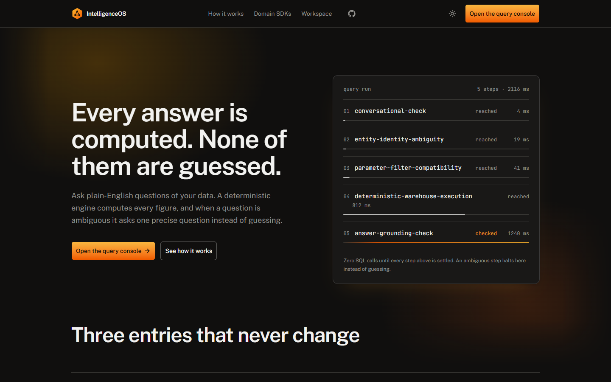
</p>

## What it is

IntelligenceOS is a universal, domain-agnostic analytics engine. The semantic resolution, query planning, execution and answerability layers know nothing about any one industry. A **Domain Pack** teaches the engine a domain's entities, metrics, vocabulary and SQL.

**Healthcare is the first Domain Pack and runs live today** on four CMS Care Compare datasets: more than 445,000 records covering 5,432 U.S. hospitals across 56 states and territories. It is the proof that the pattern works against real data. Education and Finance are an architectural direction, not shipped features.

| At a glance | |
|---|---|
| CMS datasets live in the warehouse | 4 |
| Patient survey (HCAHPS) records | 325,856 |
| Complication and death records | 95,840 |
| Readmission program records (FY 2026) | 18,330 |
| Hospitals | 5,432 across 56 states and territories |
| Counties in the geography directory | 2,473 |
| Written engineering guardrails | 22 |
| Offline test suites that run in CI with no keys | 19 |

## Why it exists

Text-to-SQL asks a model to write the query and then trusts the result. When it is wrong, it is wrong with confidence. IntelligenceOS gives every job to the component that can do it reliably:

| Job | Who does it |
|---|---|
| Understand the words: typos, slang, aliases, abbreviations | Semantic engine, plus an optional bounded LLM normalizer that fails open |
| Decide what to run | Deterministic planner and a registry of vetted SQL templates |
| Compute every number | SQL against the warehouse |
| Notice it is unsure | Ambiguity, capability and filter gates. Zero SQL runs until they pass |
| Say it in a sentence | Optional LLM summary, written from the rows the engine returned |

## See it in action

Everything below was captured from the live deployment.

### Ask a question, get a sourced answer

<table>
  <tr>
    <td width="50%">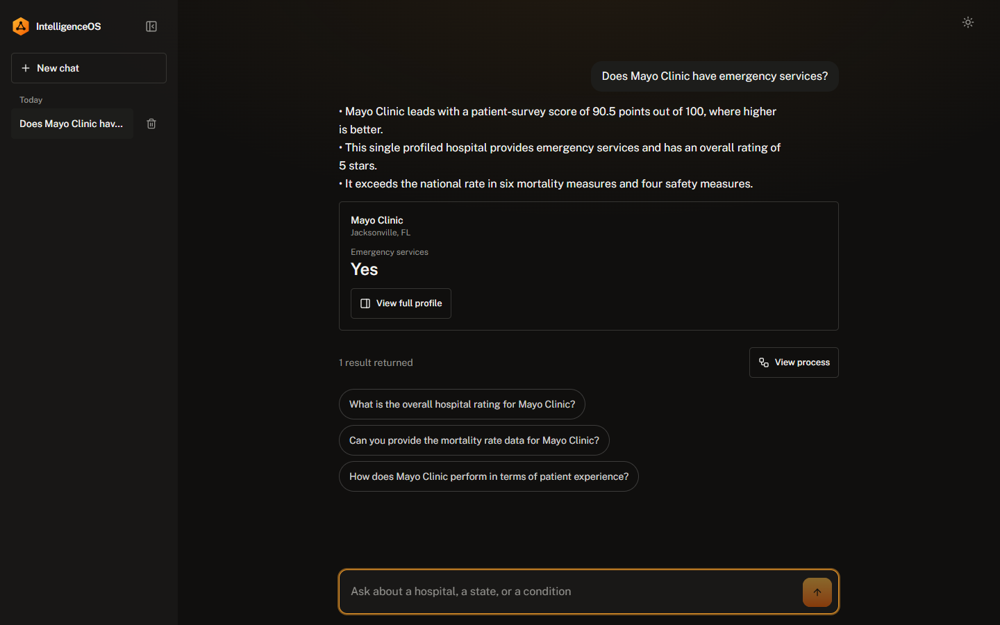</td>
    <td width="50%">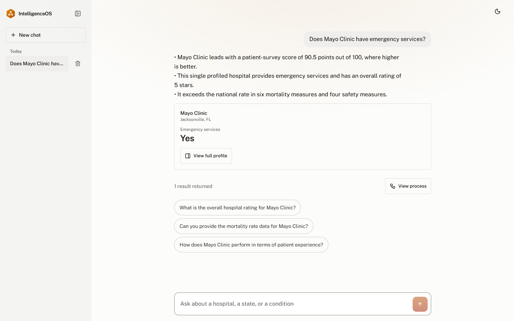</td>
  </tr>
  <tr>
    <td align="center"><sub>Dark first</sub></td>
    <td align="center"><sub>Light, from the theme toggle</sub></td>
  </tr>
</table>

### Every step is on the record

Open **View process** on any answer to see each pipeline step with its own timing, the warehouse query time, and exactly which model calls were made.

<p align="center">
  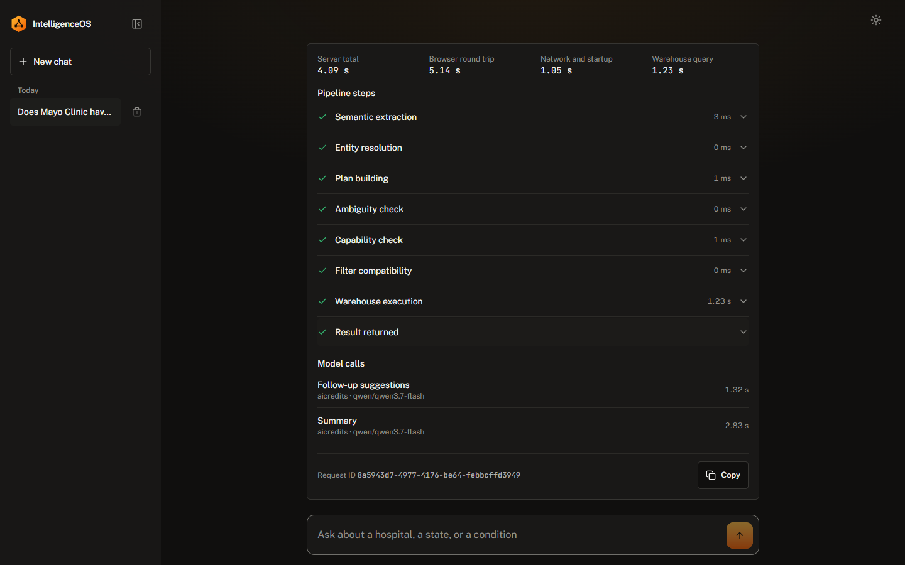
</p>

### It asks instead of guessing

"Memorial Hospital" exists in many towns. The engine does not pick one. It halts with **zero SQL calls** and asks which one you mean. Your answer resolves the original question.

<p align="center">
  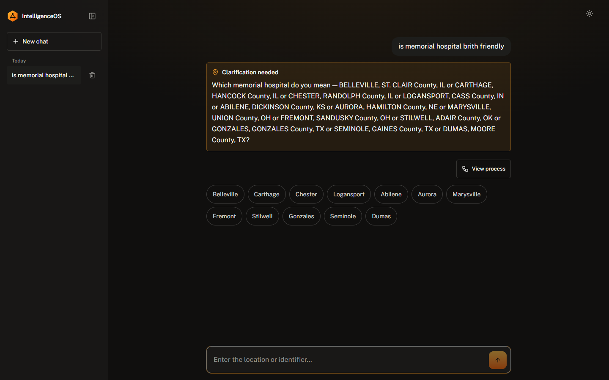
</p>
<p align="center">
  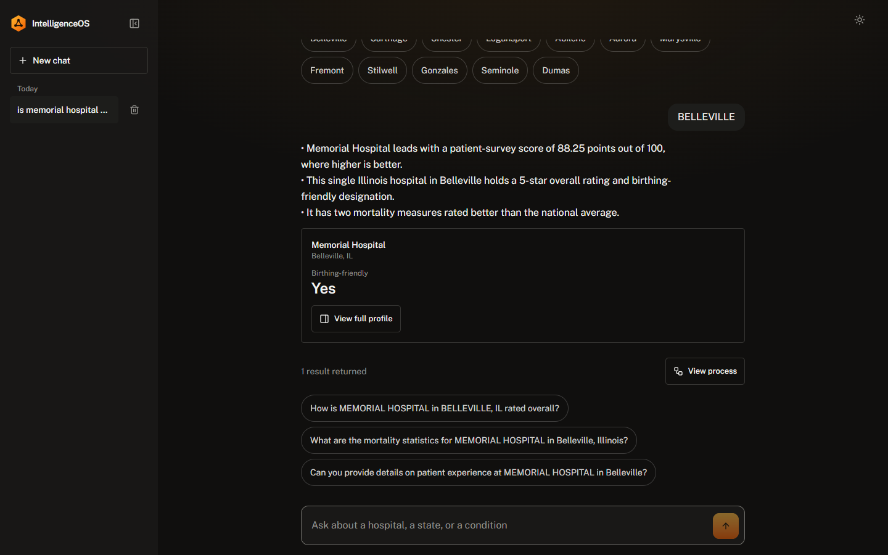
</p>

### Compare two or three hospitals side by side

Switch the list into **Compare** mode, pick up to three hospitals, and get a difference-first matrix. Picks are sent as identifiers, so same-name hospitals in different towns stay distinct and hospitals from different states compare in one answer.

<p align="center">
  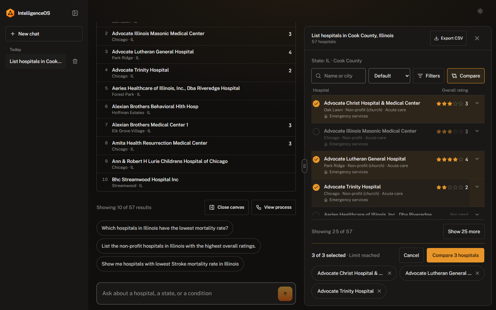
</p>
<p align="center">
  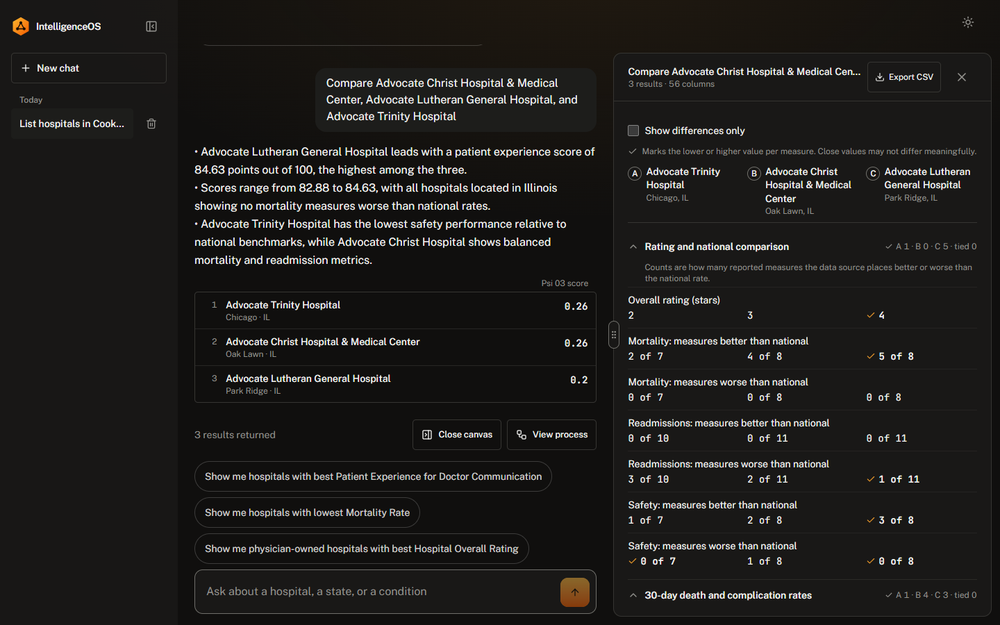
</p>

<details>
<summary><b>More screens</b>: full profile, rankings and phone layout</summary>
<br/>

**Full profile**: the result canvas opens a hospital dossier with its rating and its mortality, readmission and safety measures compared with the national rate.

<p align="center">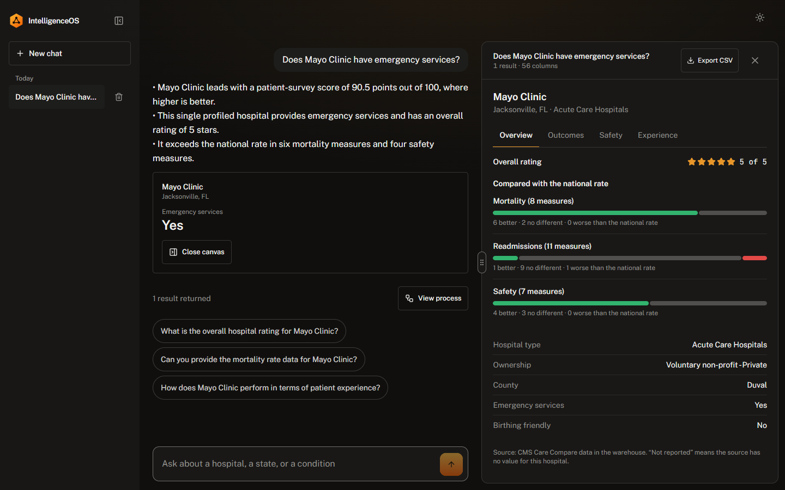</p>

**Rankings**: ordered, scoped and labelled with the measure that ranks them.

<p align="center">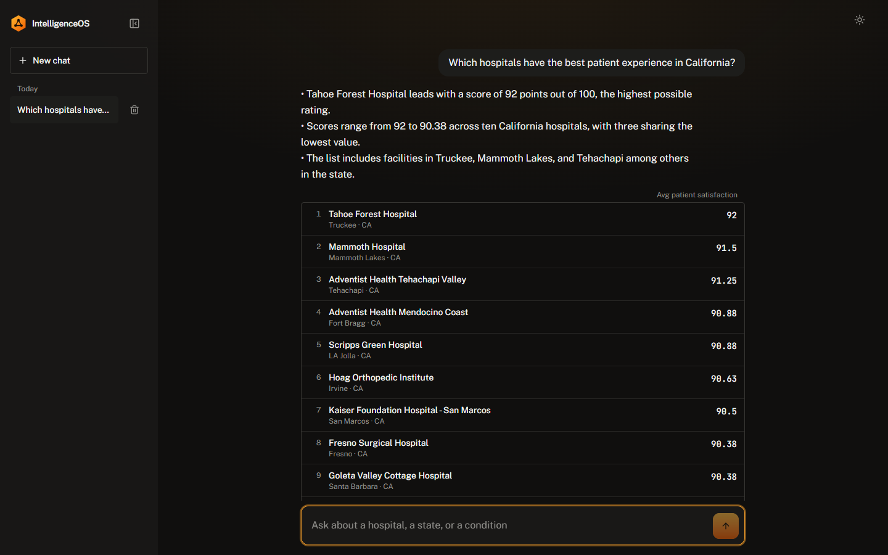</p>

**Phone**: the same workspace at 375 px, in dark and light.

<table>
  <tr>
    <td width="33%">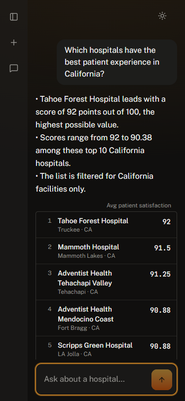</td>
    <td width="33%">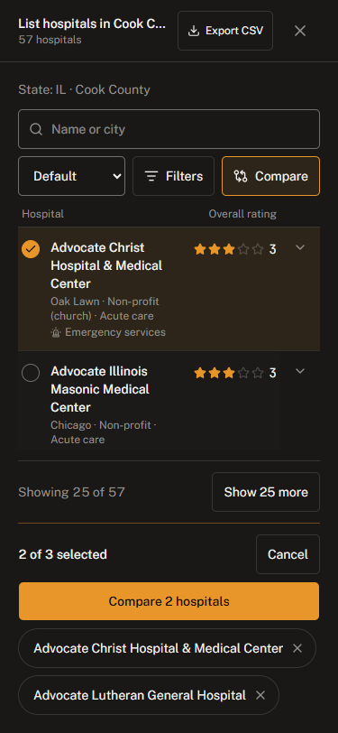</td>
    <td width="33%">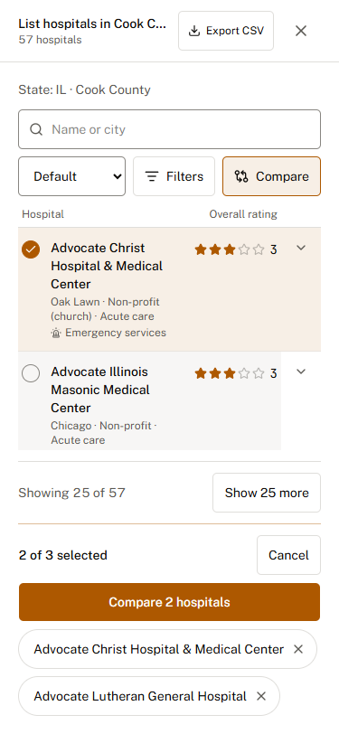</td>
  </tr>
</table>

</details>

## How it works

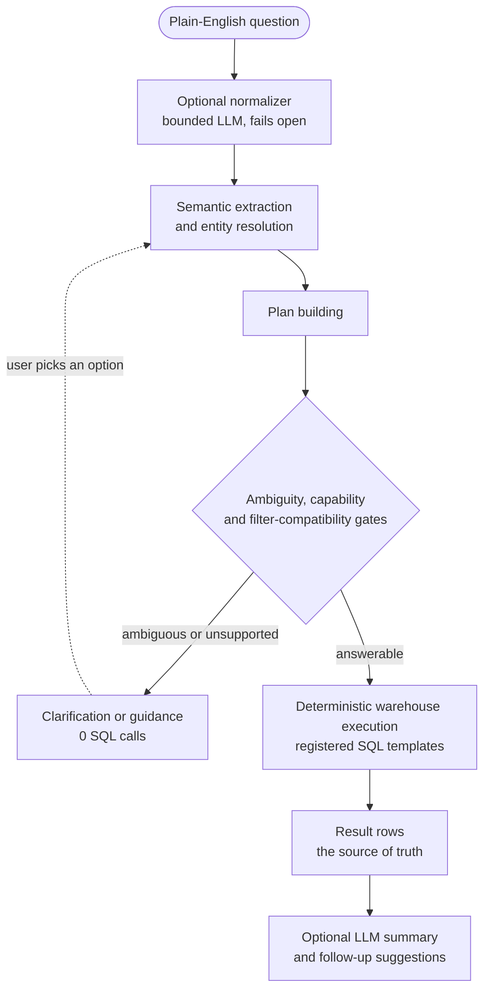

Three rules hold on every path:

1. **Deterministic data, then deterministic analytics, then an optional AI explanation.** The model never becomes the source of an analytical fact.
2. **Ambiguous means zero SQL.** A request that cannot be answered safely stops before any query exists.
3. **Every layer fails open.** If a model times out or every provider is down, the system falls back to the deterministic behaviour. It does not crash, and it does not fabricate.

The LLM-assisted layers sit around the pipeline, not inside it. A conversational front door handles greetings. A canonical-ingress normalizer rewrites messy input and hands the rewrite to a fresh, complete run of the pipeline, gates included. A continuation layer resolves a clarification answer against the pending question. Each has one narrow job, and none is trusted as truth.

## Architecture

The project is split along one line that is never crossed: **the Universal Core knows no domain; the Domain SDK owns all domain knowledge.**

```text
                        INTELLIGENCEOS UNIVERSAL CORE
   contracts · semantic · query-planner · sql-template-resolver · sql-executor
   runtime-engine · domain-runtime · domain-sdk · data-platform · llm-model-gateway
                                   │
              ┌────────────────────┼────────────────────┐
              ▼                    ▼                    ▼
        Healthcare            Education              Finance
        Domain Pack            (planned)             (planned)
         live today
```

| Package | Role |
|---|---|
| `@intelligence/contracts` | Shared contracts: entities, metrics, datasets, execution, answerability, continuation |
| `@intelligence/domain-sdk` | The Domain SDK: registries for entities, concepts, metrics, aliases, categories, dimensions, relationships, benchmarks and SQL templates |
| `@intelligence/semantic` | Semantic engine: tokenizer, phrase extraction, alias matching, ontology and entity resolution |
| `@intelligence/query-planner` | Turns semantic output into a plan: intent, filters, sort, limit, requested count |
| `@intelligence/sql-template-resolver` | Resolves a plan to a registered SQL template |
| `@intelligence/sql-executor` | Runs templates through a database adapter (Supabase, or a mock for tests) |
| `@intelligence/runtime-engine` | Composes the phases and owns the gates, clarification and continuation |
| `@intelligence/domain-runtime` | Builds a runtime and its semantic registry from a Domain Pack |
| `@intelligence/data-platform` | Ingestion: raw files, validation, normalization, entity resolution, flattening, warehouse build |
| `@intelligence/llm-model-gateway` | Multi-vendor, bounded LLM gateway with free-tier chains and structured output |
| `@intelligence/healthcare-domain` | The Healthcare Domain Pack |
| `apps/web` | The React workspace: landing page, `/chat` query console, `/settings` |
| `supabase/functions/orchestrator` | The Deno Edge Function that serves the HTTP API |

## The Healthcare domain

The pack is registered against four **CMS Care Compare** public datasets, all loaded into the live warehouse. Row counts in the warehouse match the source files:

| Dataset | Source file | Records | Warehouse table |
|---|---|---:|---|
| Patient survey (HCAHPS) | `HCAHPS-Hospital.csv` | 325,856 | `warehouse_hospital_hcahps` |
| Complications and deaths | `Complications_and_Deaths-Hospital.csv` | 95,840 | `warehouse_hospital_clinical_outcomes` |
| Hospital Readmissions Reduction Program, FY 2026 | `FY_2026_Hospital_Readmissions_Reduction_Program_Hospital.csv` | 18,330 | `warehouse_hospital_readmissions` |
| Hospital general information | `Hospital_General_Information.csv` | 5,432 | `warehouse_hospitals` |

HCAHPS is the largest, and it is **not committed**: the file is about 101 MB, over GitHub's 100 MB limit, so it is git-ignored. The other three are committed under `data/raw/healthcare/cms`. To rebuild the warehouse yourself, download "Patient survey (HCAHPS) - Hospital" from the CMS Provider Data Catalog and save it as `data/raw/healthcare/cms/HCAHPS-Hospital.csv`.

`warehouse_hospitals` also holds 10 placeholder rows named "Unknown Hospital" for facility IDs that are not in the general-information file, so its row count is 5,442.

Questions it answers today, all of them runnable on the live demo:

```text
Does Mayo Clinic have emergency services?
Which hospitals have the best patient experience in California?
List hospitals in Cook County, Illinois
Show me hospitals with lowest Pneumonia mortality rate
How many hospitals are in Texas?
Tell me about Mayo Clinic Hospital Rochester
is memorial hospital brith friendly        <- a typo, and an ambiguous name
```

> The data is public U.S. government data used for analytics demonstration. This project is not affiliated with CMS and is not medical advice.

## Quick start

**Requirements:** Node.js 20.19 or newer (CI covers 20 and 22) and pnpm 10.34 (`corepack enable` picks the pinned version up).

```bash
git clone https://github.com/Azizul-11/intelligence-os.git
cd intelligence-os
corepack enable
pnpm install
pnpm run build
```

### Run the web app

```bash
cp apps/web/.env.example apps/web/.env.local   # set VITE_ORCHESTRATOR_URL and VITE_SUPABASE_ANON_KEY
pnpm --filter web dev                           # http://localhost:5173
```

The web app needs only two **public** values: your function URL and a Supabase `sb_publishable_` key. No private key ever belongs in the client, and CI fails the build if one is inlined.

### Stand up the backend

You need your own Supabase project. Put `SUPABASE_URL` and `SUPABASE_SECRET_KEY` (your project's `sb_secret_` key) in a root `.env` for ingestion, and keep that file out of git and out of the client. LLM provider keys are optional: the deterministic engine does not need them, and only the conversational and summary layers do.

```bash
supabase link --project-ref <your-project-ref>
supabase db push                                                         # warehouse schema, registry, RLS policies

pnpm run ingest:healthcare                                               # hospital general information, run first: the others add placeholder rows for hospitals they cannot find
pnpm exec tsx scripts/ingest/ingest-healthcare-clinical-outcomes.ts      # complications and deaths
pnpm exec tsx scripts/ingest/ingest-healthcare-readmissions.ts           # readmissions
pnpm exec tsx scripts/ingest/ingest-healthcare-hcahps.ts                 # HCAHPS, needs the file described above

supabase functions deploy orchestrator
```

The function answers only allow-listed browser origins. It accepts `localhost:5173` and `:5174` by default. For a deployed site, set the secret:

```bash
supabase secrets set ALLOWED_ORIGINS="https://your-site.example,http://localhost:5173"
```

### Deploy the frontend

Any static host works. The reference deployment is Cloudflare Pages:

| Setting | Value |
|---|---|
| Build command | `pnpm install --frozen-lockfile && pnpm --filter web build` |
| Output directory | `apps/web/dist` |
| Variables | `VITE_ORCHESTRATOR_URL`, `VITE_SUPABASE_ANON_KEY` |

The router uses the History API. Cloudflare Pages serves the app shell for unknown paths on its own. Other hosts need a rewrite to `index.html`.

## Testing and CI

```bash
pnpm run typecheck       # every package, plus tsc -b for the web app
pnpm run test:ci         # 19 offline suites: no keys, no network
```

Over a hundred `scripts/verify-*.ts` suites exercise the pipeline against a live project and need a configured `.env`.

GitHub Actions runs the same gates on every pull request, keyless:

- **hygiene**: no tracked secrets or env files, and no key-shaped strings in the tree
- **build and test** on Node 20 and 22: build, typecheck, a type check of the Edge Function, a drift check on the committed edge bundles, an import-map check and the offline suites
- **client bundle scan**: a production web build in which a private key shape fails the run

`main` and `staging` are protected. Changes land by pull request, with all three checks green.

## Design

The interface is dark-first and precise, with one warm amber accent, set in Public Sans and JetBrains Mono. JetBrains Mono is reserved for measured values: timings, step names and counts. Light theme is a first-class variant, body text meets WCAG AA contrast in both themes, and the layout is built to hold at 375 px.

## Roadmap

| Status | Milestone |
|---|---|
| ✅ Done | **Phases 1 to 8**: candidate foundation, definition-driven resolution, entity resolution, semantic extraction, execution plans, multi-metric planner and runtime, explicit entity comparison, semantic validation and answerability |
| ✅ Done | **LLM layers 0 to 2**: conversational front door, canonical-ingress normalizer, continuation |
| ✅ Done | **Pre-Phase 9 hardening**: geographic ambiguity, query tracer, brand aliasing, benchmark word-order refusal |
| 🔶 In progress | **Phase 14** universal experience platform and **Phase 15** healthcare workspace: result canvas, full profile, side-by-side compare |
| ⬜ Planned | **Phase 9** deterministic analytics engine, **10** intelligence orchestrator, **11** memory and context, **12** insights, **13** conversational intelligence |
| ⬜ Planned | **Phase 16** production hardening, **17** a second Domain SDK, **18** the multi-domain platform |

## Repository layout

```text
apps/web                          React 19 + Vite + Tailwind 4 workspace
packages/                         Universal Core (domain-agnostic)
domain-packs/healthcare           Healthcare Domain Pack
supabase/functions/orchestrator   Edge Function: router, chat handler, services
supabase/migrations               Warehouse, semantic registry, RLS and trace tables
scripts/                          Ingestion, verification suites and CI gates
data/raw/healthcare/cms           CMS Care Compare source CSVs: 3 of the 4 (HCAHPS is 101 MB and git-ignored)
```

Stack: TypeScript, React 19, Vite, Tailwind 4, TanStack Query, Zustand, Framer Motion, Supabase (Postgres and Edge Functions on Deno), pnpm workspaces, Turborepo and Biome.

## Contributing

Open an issue before starting anything non-trivial. Branch from `staging`, keep the change small, and make sure the checks above pass locally. The one architectural rule that is never negotiable: **no domain knowledge in the Universal Core.** If the Education or Finance team could not reuse a file by supplying their own definitions, that file is in the wrong layer.

## License

[MIT](LICENSE) © 2026 Md Azizul Islam
